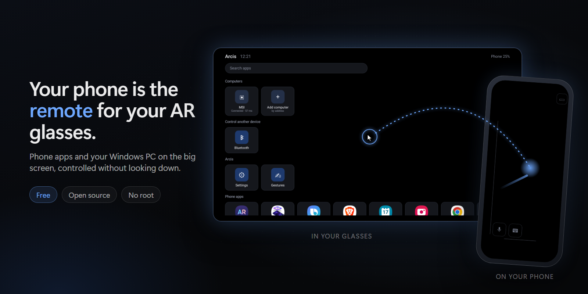
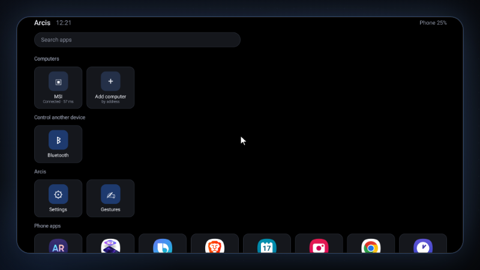
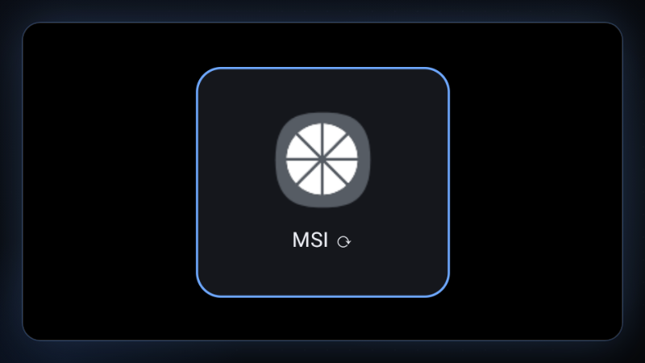
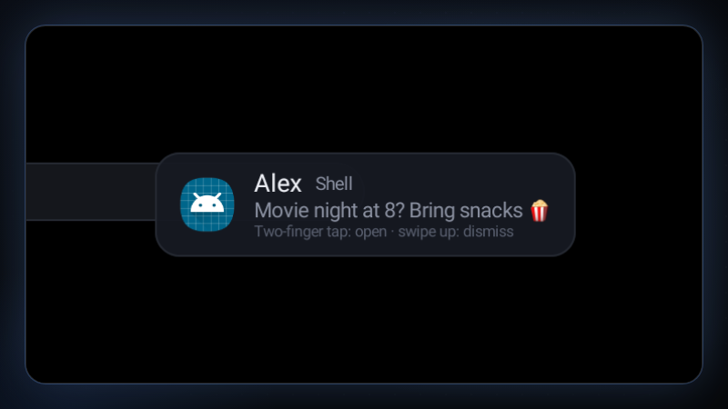
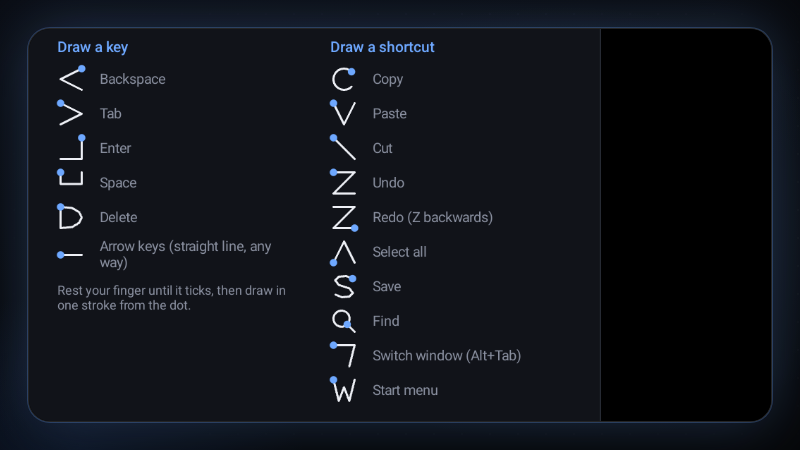
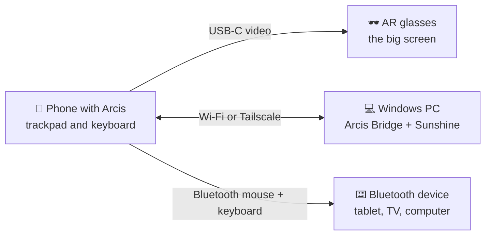
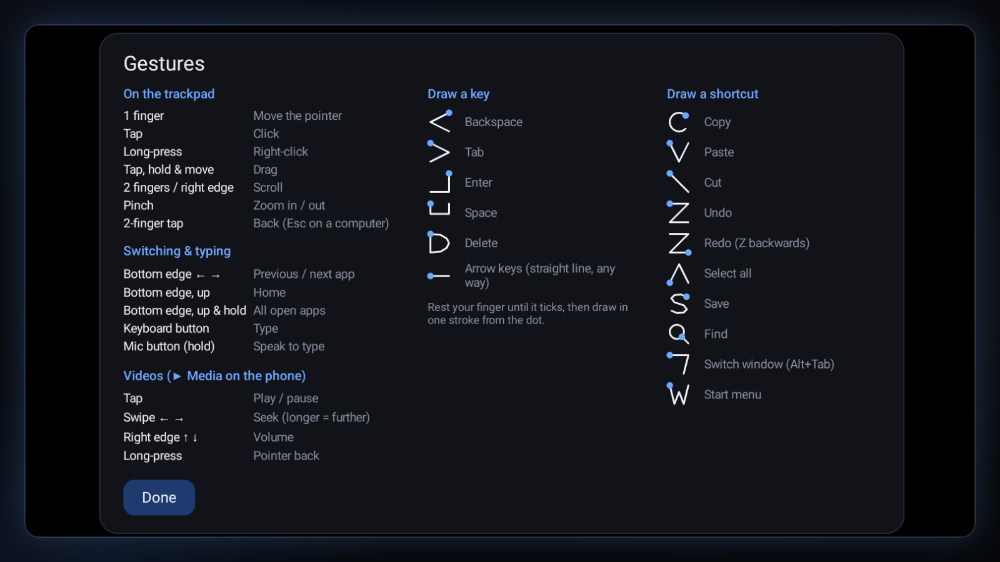

<p align="center">
  
</p>

<h1 align="center">Arcis</h1>

<p align="center">
  <a href="https://github.com/NICUP14/arcis/releases/latest"></a>
  <a href="https://github.com/NICUP14/arcis/releases"></a>
  
  
  <a href="LICENSE"></a>
  <a href="https://github.com/NICUP14/arcis/stargazers"></a>
</p>

<p align="center">
  <a href="docs/media/demo.gif"><b>▶ Watch the demo</b></a> (18 s)
</p>

<p align="center">
  <a href="https://github.com/NICUP14/arcis/releases/latest"><b>Download</b></a> ·
  <a href="docs/getting-started.md">Getting started</a> ·
  <a href="docs/using-arcis.md">How to use it</a> ·
  <a href="docs/troubleshooting.md">Help</a>
</p>

<p align="center">
  
</p>

Display glasses such as XREAL, VITURE, RayNeo or Rokid show a big virtual screen, but controlling what's on it is
awkward: you look down at the phone, find the button, look up again. **Arcis** turns your phone into a trackpad and
keyboard for the glasses, like the one on a laptop. One full-screen app at a time, switched like on a phone.

No root, no special phone, no account.

## What Arcis does

<table>
  <tr>
    <td width="50%" valign="top">
      
      <h3>Phone apps on the big screen</h3>
      Netflix, YouTube, the browser, WhatsApp… open full screen in the glasses. Arcis Home lists your computers,
      devices and apps in one place.
    </td>
    <td width="50%" valign="top">
      
      <h3>Your Windows PC, too</h3>
      Your desktop appears in the glasses through the free <a href="https://moonlight-stream.org">Moonlight</a> app,
      and the phone controls it. At home or <a href="docs/away-from-home.md">anywhere else</a>.
    </td>
  </tr>
  <tr>
    <td width="50%" valign="top">
      
      <h3>Messages while you watch</h3>
      New messages pop up as small banners. Two-finger tap opens one, swipe up dismisses it. The text is shown in the
      glasses only and never sent anywhere.
    </td>
    <td width="50%" valign="top">
      
      <h3>Draw a letter for a shortcut</h3>
      Rest a finger until it ticks, then draw: C copies, V pastes, Z undoes, W opens the Start menu. Or hold the mic
      button and speak to type.
    </td>
  </tr>
</table>

Also: **any Bluetooth device** (a tablet, a TV, another computer) can use your phone as its mouse and keyboard.

## How it works



The glasses are a screen for the phone. Arcis shows its Home and your apps on them, and turns the phone's own screen
into a trackpad. For your PC, the [Arcis Bridge](docs/computer.md) sets up [Sunshine](https://github.com/LizardByte/Sunshine)
on the PC, Moonlight on the phone shows the desktop in the glasses, and Arcis sends your touches to the Bridge.

## Use it without looking

<p align="center">
  
</p>

Swipe to move the pointer, tap to click, swipe along the bottom edge to switch apps. When a video plays, tap to pause
and swipe to skip, with no aiming. The same list is always one tap away on Arcis Home.
[All the gestures](docs/using-arcis.md).

## What you need

| | |
|---|---|
| **Glasses** | Display glasses or any external screen that connects over **USB-C** (XREAL, VITURE, RayNeo, Rokid, portable monitors…). |
| **Phone** | **Android 11 or newer** with **video output over USB-C** (DisplayPort). Most Samsung Galaxy S, Note, Z Fold and Tab models do; many other flagships too. Your glasses maker usually has a compatibility list. |
| **For your PC (optional)** | A **Windows 10/11** PC, plus the free [Moonlight](https://moonlight-stream.org) app on the phone. Arcis installs the rest for you. |

**Tested on** a Galaxy S20 FE (Android 13) with XREAL 1S glasses and a Windows 11 PC. Other phones and glasses haven't
been tried yet. Used it with something else? [Tell us how it went](https://github.com/NICUP14/arcis/issues/new?template=device-report.yml),
good or bad.

> [!TIP]
> Glasses take power from the phone. For long sessions, use a USB-C hub or adapter that charges the phone while the
> glasses are connected.

## Quick start

1. **Download** `Arcis-x.y.z.apk` from the [latest release](https://github.com/NICUP14/arcis/releases/latest)
   on your phone and install it ([how?](docs/getting-started.md#2-install-the-app)).
2. **Open Arcis** and follow the short checklist. It explains each permission and takes
   you to the right settings screen.
3. **Plug in your glasses.** Arcis Home appears in them.
4. **Use the phone as a trackpad**: slide a finger to move the pointer, tap to open.
5. **Want your PC too?** Install `ArcisBridge-x.y.z.msi` on the PC and scan the code
   it shows ([guide](docs/computer.md)).

The [getting started guide](docs/getting-started.md) walks through every step.

## Documentation

**Using Arcis**

- [Getting started](docs/getting-started.md): install, set up, first steps
- [How to use Arcis](docs/using-arcis.md): gestures, switching apps, typing, videos, settings
- [Your PC on the glasses](docs/computer.md): Arcis Bridge, Moonlight and Sunshine
- [Away from home](docs/away-from-home.md): reach your PC over the internet with Tailscale
- [Troubleshooting](docs/troubleshooting.md): when something doesn't work

**Technical**

- [Arcis Bridge reference](docs/bridge.md): options, Linux/macOS (untested), security
- [Bridge protocol](docs/protocol.md)
- [Testing without glasses](docs/testing.md)
- [Making a release](docs/releasing.md)

## Privacy

No account, no ads, no analytics and no servers. Everything stays between your phone, your glasses and your own PC.

<details>
<summary>More detail</summary>

Notification text is shown in the glasses only and never sent anywhere. The connection to your
PC is encrypted and needs a one-time pairing.

</details>

## Build from source

<details>
<summary>Phone app and Arcis Bridge</summary>

```sh
# Phone app (JDK 17, Android SDK 37)
cd android
./gradlew test assembleDebug        # APK in app/build/outputs/apk/debug/

# Arcis Bridge (Go 1.26)
cd bridge
go test ./...
./build.ps1                         # Windows: tray app + installer in dist/ (needs WiX 5)
```

| Folder | What's inside |
|---|---|
| `android/` | The phone app (Kotlin, Jetpack Compose). `core` holds the logic with unit tests. |
| `bridge/` | The Arcis Bridge for the PC (Go). Windows is tested; Linux and macOS build but are untested. |
| `docs/` | Guides. `docs/media/` holds the README images and the script that renders them. |

</details>

## Contributing

Arcis is young, and reports are the most useful help right now: a
[device report](https://github.com/NICUP14/arcis/issues/new?template=device-report.yml) for a phone or glasses we
haven't tested, or a [bug report](https://github.com/NICUP14/arcis/issues/new?template=bug.yml). Pull requests are
welcome too.

## Thanks

Arcis stands on the shoulders of [Moonlight](https://moonlight-stream.org) and
[Sunshine](https://github.com/LizardByte/Sunshine), which do the hard work of streaming
your PC. Arcis is not affiliated with them or with any glasses maker.

## License

[MIT](LICENSE): free to use, change and share.
