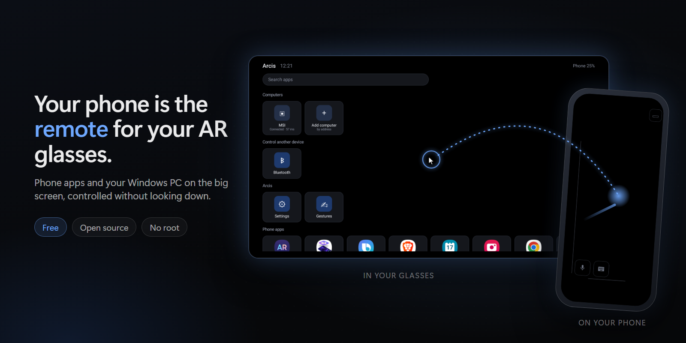

## What's new

<!--
  A few bullets, one per change people will notice. Start with the most exciting one.
  A screenshot or short clip makes a release far more inviting: drag it into this text box
  on the GitHub release page, or render one with docs/media/render.ps1.
-->

**New here?** Start with the [getting started guide](https://github.com/NICUP14/arcis/blob/main/docs/getting-started.md).

| File | What it is |
|---|---|
| `Arcis-<version>.apk` | The phone app (Android 11 or newer). Download it on your phone and install it. |
| `ArcisBridge-<version>.msi` | Only if you want your **Windows** PC in the glasses. Install it on the PC ([guide](https://github.com/NICUP14/arcis/blob/main/docs/computer.md)). |
| `SHA256SUMS.txt` | Checksums, to check the downloads (optional). |

Windows may say "Windows protected your PC" for the installer (it isn't code-signed yet): click **More info › Run anyway**.
